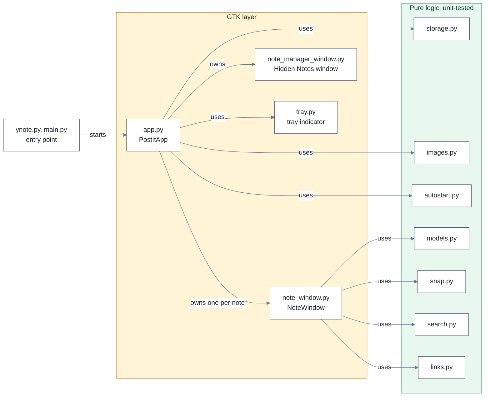
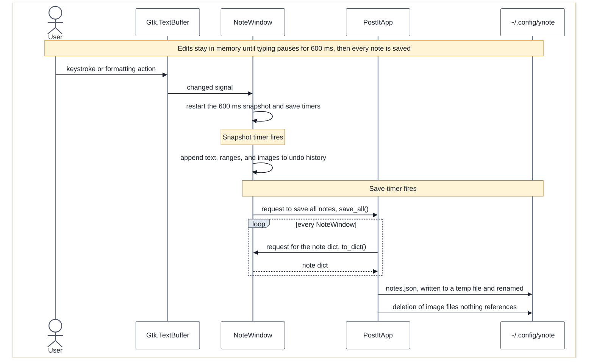

# Ynote Architecture

Ynote is a single-process GTK 3 app written in Python with PyGObject. One
`Gtk.Application` (`PostItApp`) owns every note window, and each note is a
`NoteWindow` holding a `Gtk.TextView`. Everything a user creates is saved
under `~/.config/ynote/`.

## Modules

This diagram shows which module owns or uses which. The pure modules have no
GTK dependency, so they are unit-tested without a display.



| Module | Responsibility |
| --- | --- |
| `ynote.py`, `ynote/main.py` | Entry point. Handles `--version`, selects GTK's X11 backend, then runs `PostItApp`. |
| `ynote/__init__.py` | Holds `__version__`, the only place the version is set. |
| `ynote/app.py` | Application lifecycle, tray icon, the set of notes, hidden-note order, the shared rich clipboard, and saving. |
| `ynote/note_window.py` | One note: its window, text editing and formatting, undo/redo, search, images, snapping, and the right-click popover with color, opacity, and font size. |
| `ynote/note_manager_window.py` | The Hidden Notes window: list, reorder, and restore hidden notes. |
| `ynote/tray.py` | Loads the application indicator library and makes the tray indicator, which the desktop draws and positions. Also words the tray menu's labels. |
| `ynote/models.py` | Fills defaults into saved note data, so older `notes.json` files still load. |
| `ynote/storage.py` | Reads JSON files and writes them atomically. |
| `ynote/images.py` | Image metadata, and finding and deleting image files no note uses. |
| `ynote/snap.py` | Computes a snapped note rectangle from monitor work areas. |
| `ynote/search.py` | Finds a query in every note for the search bar's All notes mode. |
| `ynote/links.py` | Finds `http` and `https` URLs in note text. |
| `ynote/autostart.py` | The per-user login autostart entry. |
| `ynote/config.py` | Paths and constants. |
| `ynote/styles.py` | The note color palette and the GTK CSS built from it. It has no GTK import, so it is unit-tested. |

## Note data model

`notes.json` is a list with one object per note. Formatting is stored as
character ranges over plain text, not as markup:

```json
{
  "id": "0b6e…", "title": "tmux", "text": "Sessions\ntmux new -s work",
  "x": 120, "y": 80, "w": 300, "h": 320,
  "on_top": false, "hidden": false, "sort_order": 0.0, "font_size": 14,
  "color": "yellow", "opacity": 1.0, "collapsed": false,
  "bold_ranges": [], "heading_ranges": [[0, 8]], "code_ranges": [[9, 25]],
  "backtick_ranges": [],
  "images": []
}
```

| Field | Meaning |
| --- | --- |
| `text` | The note text, including the special characters below. |
| `bold_ranges`, `heading_ranges`, `code_ranges`, `backtick_ranges` | `[start, end)` character offsets into `text`. GTK buffer offsets count characters, so they match Python string indices. |
| `images` | `{file, original_name, offset}` per image. `offset` is where its placeholder character sits in `text`. |
| `x`, `y`, `w`, `h` | Window position and size. A maximized note saves the rectangle it had before, and a collapsed note saves its expanded height as `h`. |
| `hidden`, `sort_order` | Whether the note is hidden, and its place in the Hidden Notes list. |
| `on_top`, `font_size` | Always-on-top and the note's font size. |
| `color` | A name from the palette in `styles.py`. An unknown name loads as the default, `yellow`. |
| `opacity` | Background opacity from `0.0` to `1.0`, clamped on load. Only the note body is see-through. The title bar, bottom bar, and text stay opaque. |
| `collapsed` | Whether the note is shown as its title bar only. |

Some structure lives in the text itself:

| In `text` | Meaning |
| --- | --- |
| `U+FFFC` (`IMAGE_ANCHOR`) | Where an image is shown. |
| `U+2060` (`CODE_ANCHOR`) | An invisible character that lets an empty line carry the code tag. It is stripped when text goes to the system clipboard, and tagged `invisible` by `_hide_code_anchors()` so that GTK leaves it out of the selection that middle click pastes and of a drag. Text read from the buffer therefore includes hidden characters. |
| `• `, `☐ `, or `☑ ` at the start of a line | A bullet, an open to-do, or a done to-do. Each nesting level adds four leading spaces. |
| A line that is exactly `---` | A divider. The dashes are hidden and `_draw_dividers()` paints a line over them. |

Emoji sizing, dividers, grayed-out done to-dos, links, and search
highlights are tags derived from the text while the app runs, and are never
saved. A version without one of these features still shows the text as is.

Other files under `~/.config/ynote/`:

- `images/` holds a copy of every inserted image, named by a UUID, so a note
  keeps working after the original file moves.
- `settings.json` records app-wide state. Today that is only whether login
  autostart was already set up once.

## Editing, undo, and saving

This diagram shows what an edit causes, from the keystroke to the files on
disk.



- Moving or resizing a note also starts the save timer.
- Undo history keeps the last 100 states per note and lives only in memory.
- While the app runs, an image is kept if a note, any note's undo history, or
  the rich clipboard still refers to it. That way undo can bring back a
  deleted image. Quitting saves once more and keeps only images the saved
  notes use.

## Startup

1. `main()` sets `GDK_BACKEND=x11` before GTK loads. Otherwise GTK would pick
   any Wayland socket it finds. See [Why X11](#why-x11).
2. `PostItApp.do_startup()` creates the config directories, sets up login
   autostart on an installed app's first run, loads the CSS, and creates the
   tray icon.
3. `_load()` copies `notes.json` to `notes.json.bak`, creates a `NoteWindow`
   for each saved note, or one empty note when there are none, then deletes
   image files no saved note uses. If `notes.json` exists but cannot be
   read, it is renamed to `notes.json.broken-<time>` instead of being
   overwritten, the user is warned, and image cleanup is skipped for that run
   so the kept notes' images survive. A note whose window fails to open is
   kept as it was read and saved back unchanged, with image cleanup skipped
   and a warning, so a bug in opening notes never deletes them.

## Other mechanisms

- **Rich copy and paste between notes.** Copying in a note stores the text,
  ranges, and images in `PostItApp` and puts plain text on the system
  clipboard. Pasting uses the stored state only while Ynote still owns the
  clipboard, so text copied elsewhere afterwards pastes as plain text.
- **Login autostart.** `autostart.enable_on_first_run()` writes
  `~/.config/autostart/ynote.desktop` once per user, and only when the
  `ynote` command is installed. The Start at Login menu item adds or removes
  that file.

- **Color and opacity.** Each note has one `Gtk.CssProvider` built by
  `styles.note_css()`, attached to the window and both bars. The alpha needs
  an RGBA visual set before the window is realized. Below 100%,
  `_draw_text_backing()` paints an opaque strip behind each row of text so it
  stays readable.
- **Line spacing.** Every line has the same spacing, set on the text view,
  whatever its format. Its total is `LINE_SPACING`, or a pixel more where the
  fonts need it, and how it divides above and below is worked out from them so
  that an inline code box sits in the middle of its line. Code boxes may
  reach into it.
- **List markers.** A bullet or a to-do box is not text to the user, though it
  is characters in the note (`• `, `☐ `, `☑ `), so notes saved before and the
  clipboard keep working. Everything that treats text as text steps around it:
  `_marker_end()` says where a marker ends, the cursor and the ends of a
  selection are moved out of one once GTK has moved them, a format is applied
  with `_tag_text()` to the text after the marker and never to a line break,
  since a format on a break reaches into the next line and moves its indent,
  a list item is never made a heading or a line of code, and Backspace at the
  start of an item outdents it one level, or removes the whole marker from one
  at the top level. Each level is a tab, as wide as `INDENT_SPACES` spaces of
  the note's font; an item indented by spaces, as items were before, gets tabs
  when its note opens. Moving left from the start of an item goes on to the end
  of the line before, while selecting left takes the whole marker first and
  the line break with the next step; a mouse selection takes a marker it
  reaches over. A bullet in a line of code is code, with no marker. The
  characters are drawn transparent by a derived tag, scaled to fit in the line
  and spaced to take the room the drawing needs, and `_draw_list_markers()`
  draws a filled circle or a box, sized by `BULLET_SIZE` and `CHECKBOX_SIZE` in
  em, over them. Because the drawing does not come from a font, a larger one
  does not make its line taller.
- **Even lines.** A line is as tall as the tallest font that draws it, and
  the note's font lacks most scripts other than Latin, so a line of Hangul,
  Japanese, Arabic, or Thai is drawn in whichever font this computer falls back
  to, and its height differs from a line of Latin. In a note with such text,
  `_even_lines()` lays out each line whole in the note's font, as it is in the
  note, so Pango picks the same fonts, and reads its ascent and descent the
  way GTK rounds them. `even_slots()` then gives every line the spacing that
  puts its baseline the same distance from the top and bottom of the room it
  takes: the most any line needs, and no less than a Latin line has. A font
  with room of its own takes the place of the spacing, so lines are no
  further apart than they have to be. Nothing in it names a font or a script.
  Emoji, and the dingbats drawn like them, keep their own height; headings,
  code, and dividers are spaced on their own. Notes without non-Latin text are
  unchanged.
- **Code boxes.** Code blocks and inline code share one box, as in CSS: the
  font's line area plus padding, `CODE_PAD` on the sides and `CODE_PAD_Y`
  above and below, so the padding is the same on all sides and does not depend
  on which letters are inside. They have a light gray background for a block
  and a darker one for inline code. A code block also keeps
  `CODE_BLOCK_MARGIN` from the lines around it. `_refresh_code_spacing()`
  scales code text so its lowercase letters are as tall as the body's, and
  works out the spacing from the fonts.
- **Code blocks.** `_draw_code_blocks()` draws one outlined box per run of code
  lines, as wide as the longest line. A multi-line selection inside a code
  block is drawn there too, because GTK would paint it across the whole note.
  The room inside the box is line spacing on the code tag.
- **Inline code.** A text tag cannot have an outline or padding, so the tag
  only sets the font and color, and `_draw_inline_code()` draws the outlined
  box around the characters of each display line of every `backtick_ranges`
  range. The box is placed from the code character's own rectangle, whose
  top is the top of the code font, raised with it, not the top of the row.
  The ranges keep the name of the backticks that typed them, which are
  removed once the text is styled.
- **Padding of inline code.** A text view makes room for nothing but
  characters, and letter spacing, which Pango splits between both sides of a
  character, cannot make room beside a letter without opening a gap on its far
  side. So the padding is an en space (`CODE_PAD_CHAR`) at each end of the
  range, tagged as code and set in the body font by `_pad_tag`. It is half an
  em wide, which is the padding and the gap from the text beside the code:
  the box is drawn `CODE_GAP` inside it at each end. It is not a space
  shrunk to a width: GTK draws the cursor as tall as the font of the
  character after it, so a smaller space gave a smaller cursor beside the
  code, and the space of the body font is too narrow.
  `_normalize_code_pads()` gives every range its two spaces and removes one
  that is only spaces, whenever the text changes and when a note is loaded,
  restored, or pasted into, so an old note gets them the first time it is
  opened, with a plain space at an end of a range made one, and a range that
  comes from typing, a selection, or backticks has them too. They are in the
  saved text, and Ctrl+C leaves them out. An en space may only be at the end
  of a range as its padding: `_pad_kind()` says which one it is.
- **The cursor and the padding.** The cursor is inside the code on one side
  of a padding space and outside on the other, and `_sync_format_state()`
  takes that from `_pad_kind()`. Turning code on or off at an edge steps the
  cursor over the space, so it is where the text will go, as in Slack. In the
  middle of code, turning it off changes no text, and what is typed there makes
  two ranges, which `_normalize_code_pads()` gives their spaces. Backspace and
  Delete next to a padding space take the character beyond it, since the box
  has no character of its own there. A selection never ends on a padding
  space (`_keep_pads_out_of_selection()`): an end moved by a key goes on past
  it, and one dragged by the mouse stops short of it.
- **Room around code.** Like dividers, `_apply_code_margins()` derives tags
  from the text after every change: spacing above the first and below the last
  line of a code block, and `_pad_tag` on the padding spaces. It runs once the
  edit is done, because a line typed into a code block gets its tag after the
  buffer reports the change.
- **Formats at the cursor.** Bold, inline code, and heading are each on or off
  at the cursor, shown on the B, H, and `</>` buttons. `_sync_format_state()`
  takes them from the text the cursor is attached to whenever it moves, also
  when deleting text or undoing moves it, a button or shortcut toggles one, typed text gets the ones that are on
  and none of the others, also inside a bold or code range, which splits it,
  and Enter turns them all off. `heading_ranges` cover whole lines, so on an empty
  line Heading applies to the text typed there next. A heading is already
  bold, so in one B is off and disabled, and making a line a heading removes
  its bold.
- **Right-click popover.** A `Gtk.Popover` is drawn inside the window it is
  attached to, so one that does not fit the note, always the case for a
  collapsed note, is attached to a transparent window of its own.
- **Collapse.** A collapsed note hides everything below the title bar and
  cannot be resized, which keeps the window manager from tiling or maximizing
  an empty note. A maximized or tiled note cannot be collapsed, because the
  window manager ignores its resizes.

## Why X11

Ynote always runs on GTK's X11 backend, through XWayland on a Wayland session.
Native Wayland does not let an app place its own windows or keep them on top,
and Ynote depends on both for saved positions, snapping, and pinning. The tray
icon is an application indicator, which the desktop draws and positions. It
replaced `Gtk.StatusIcon`, an X11 mechanism whose menu GNOME Shell under Wayland
opened in the middle of the screen.

## Testing

The pure modules have unit tests in `tests/`. GTK code is covered by the
headless smoke test, which launches the real app. See
[CONTRIBUTING.md](CONTRIBUTING.md#test).
