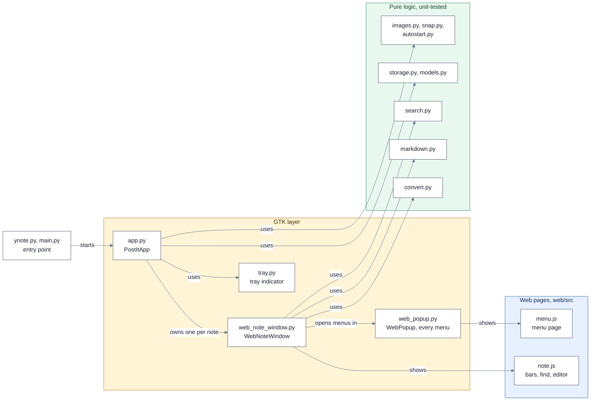
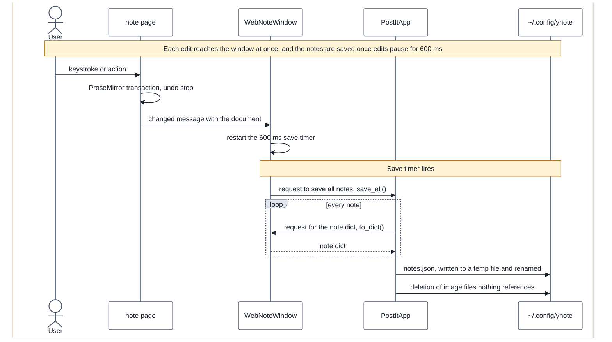

# Ynote Architecture

Ynote is a single-process GTK 3 app written in Python with PyGObject. One
`Gtk.Application` (`PostItApp`) owns every note window. Each note is a
frameless GTK window holding a WebKit web view, and the whole note is the
web page: its title bar, bottom bar, find bar, and a ProseMirror editor, the
editor Confluence's is built on. The window does what only a window can.
Everything a user creates is saved under `~/.config/ynote/`.

## Modules

This diagram shows which part owns or uses which. The pure modules have no
GTK dependency, so they are unit-tested without a display.



| Module | Responsibility |
| --- | --- |
| `ynote.py`, `ynote/main.py` | Entry point. Handles `--version`, selects GTK's X11 backend, then runs `PostItApp`. |
| `ynote/__init__.py` | Holds `__version__`, the only place the version is set. |
| `ynote/app.py` | Application lifecycle, the tray, the set of notes, the hidden notes' order, Alt+scroll, the clipboard Ynote keeps, and saving. |
| `ynote/web_note_window.py` | `WebNoteWindow`, one note's window: position, size, moving and resizing on the page's request, collapse, keep on top, hide, snapping, opacity, the clipboard, finding in every note, and saving. |
| `ynote/web_popup.py` | `WebPopup`, the one popup window that shows every note's menus, so a menu may reach past its note. |
| `ynote/web_view.py` | Makes the web views: one web process for all, a content manager each, nothing navigating away. |
| `ynote/web/` | The pages, `note.html` and `menu.html`, their CSS, and the bundles `note.js` and `menu.js` built from `web/src/`. |
| `web/src/` | The pages' code, bundled by `web/build.sh`: `actions.js` (every action once: name, icon, Markdown, keys), `schema.js` (what a note holds), `editor.js` (keys, typed Markdown), `commands.js` (editing), `structure.js` (rules the content keeps), `views.js` (expand, to-do, and code block buttons), `links.js`, `find.js`, `slash.js` (the / menu), `menus.js` (what each menu holds), `chrome.js` (the bars, the find bar, the menus' coming and going), `note.js` (`window.ynote`), `menu.js` (the menu page and the emoji picker), `emoji-data.js` (made by `make-emoji.mjs`). |
| `ynote/convert.py` | Turns a note of Ynote 1.x, text with ranges, into a document; a document into plain text for search; and a document's blocks into a 1.x rich state, which `markdown.py` reads. |
| `ynote/markdown.py` | A rich state to Markdown for the clipboard, and pasted Markdown back. |
| `ynote/search.py` | Finds a query in every note, for find's All notes. |
| `ynote/tray.py` | Loads the application indicator library and makes the tray indicator, which the desktop draws and positions. Also words the tray menu's labels. |
| `ynote/focus.py` | Brings a window forward at the X server's time, which GNOME takes as the user's own request. |
| `ynote/models.py` | Fills defaults into saved note data, so older files still load. |
| `ynote/storage.py` | Reads JSON files and writes them atomically. |
| `ynote/images.py` | Finding and deleting image files no note uses. |
| `ynote/snap.py` | Snapped and placed note rectangles from monitor work areas. |
| `ynote/autostart.py` | The per-user login autostart entry. |
| `ynote/config.py` | Paths and constants, among them the characters 1.x kept in a note's text. |
| `ynote/styles.py` | The names of the note colors. |
| `ynote/fonts/` | The Black weight of Noto Serif and Noto Serif KR, for bold in a heading, which most systems lack, with their SIL Open Font License. The page loads them by `@font-face`. |

## Note data model

`notes.json` is a list with one object per note, in UTF-8 with text such as
Korean as it is (`storage.to_json()`):

```json
{
  "id": "0b6e…", "title": "tmux",
  "doc": {"type": "doc", "content": [
    {"type": "heading", "content": [{"type": "text", "text": "Sessions"}]},
    {"type": "code_block", "content": [{"type": "text", "text": "tmux new -s work"}]},
    {"type": "paragraph"}]},
  "x": 120, "y": 80, "w": 300, "h": 320,
  "on_top": false, "hidden": false, "sort_order": 0.0, "font_size": 14,
  "color": "yellow", "opacity": 1.0, "solid_in_use": true, "collapsed": false,
  "stack": 0
}
```

| Field | Meaning |
| --- | --- |
| `doc` | The note's ProseMirror document as JSON (`web/src/schema.js`). A bullet and a to-do are items of one list (`list_item.attrs.checked` is `null` for a bullet), an expand is a node holding a title and blocks, a table's first row holds header cells, and its cells hold any block but a table. An image names its file in `images/`. Links are found in the text as it changes, and not saved. |
| `x`, `y`, `w`, `h` | Window position and size. A maximized note saves the rectangle it had before, and a collapsed note saves its expanded height as `h`. |
| `hidden`, `sort_order` | Whether the note is hidden, and its place among the hidden notes. |
| `stack` | Where the note was in the stack of windows, so the next start stacks them the same; -1 when hidden. |
| `on_top`, `font_size` | Always on top and the note's font size. |
| `color` | A name from `styles.PALETTE`. An unknown name loads as the default, `yellow`. |
| `opacity`, `solid_in_use` | How far below the title bar the note fades, from `0.0` to `1.0`, and whether it is solid while in use. |
| `collapsed` | Whether the note is shown as its title bar only. |

A note without `doc` is one Ynote 1.x saved: text with ranges, and
structure kept as characters in it (`config.py`). It opens converted
(`convert.note_doc()`).

Other files under `~/.config/ynote/`:

- `images/` holds a copy of every inserted image, named by a UUID, so a note
  keeps working after the original file moves.
- `settings.json` records app-wide state: whether login autostart was set up
  once, find's Match case, regular expression, and All notes, and the emoji
  used last.
- `notes-old.json` is the file of Ynote 1.x, kept as it was when 2.0 first
  opened it: 1.x cannot read what 2.0 saves.

## Editing and saving

This diagram shows what an edit causes, from the keystroke to the files on
disk.



- Moving or resizing a note also starts the save timer.
- Undo history lives in the page, in memory.
- While the app runs, an image is kept if a note has shown it in this run,
  which covers its undo history, or the clipboard Ynote keeps refers to it.
  Quitting saves once more and keeps only images the saved notes, or
  `notes-old.json`, use.

## Startup

1. `main()` sets `GDK_BACKEND=x11` before GTK loads. Otherwise GTK would pick
   any Wayland socket it finds. See [Why X11](#why-x11). It also sets
   `IBUS_ENABLE_SYNC_MODE=1`, unless set, so that an input method such as
   Korean's answers each key in turn: answered asynchronously, a busy computer
   took keys out of order, and Enter after a Korean word could land after the
   next word had started.
2. `PostItApp.do_startup()` creates the config directories, sets up login
   autostart on an installed app's first run, and creates the tray icon.
3. `_load()` copies `notes.json` to `notes.json.bak`, creates a window for
   each saved note, or one empty note when there are none, then deletes
   image files no saved note uses. Notes Ynote 1.x saved are copied to
   `notes-old.json` first, and saved as 2.0 saves them once open. If
   `notes.json` exists but cannot be read, it is renamed to
   `notes.json.broken-<time>` instead of being overwritten, the user is
   warned, and image cleanup is skipped for that run so the kept notes'
   images survive. A note whose window fails to open is kept as it was read
   and saved back unchanged, with image cleanup skipped and a warning, so a
   bug in opening notes never deletes them.
4. `do_activate()`, which also runs when Ynote is started while it runs,
   brings the visible notes forward. When none is visible, it shows the one
   hidden note where it was, or lists the hidden notes at the pointer when
   more are hidden, or makes a new note at the pointer when none is.

## Mechanisms

- **Page and window.** The page sends JSON messages through
  `window.webkit.messageHandlers.ynote`; `_on_message()` runs `_do_<type>()`.
  `ready` makes the window send the note with `ynote.load()`, `changed`
  carries the document after every edit, and `move` and `resize` start a move
  or resize from the mouse press the window saw last, as a window manager
  needs. The window changes the page with `ynote.set()`.
- **One web process.** Every note's web view is related to another's, so all
  pages run in one web process: one each would take about 250 MB per note.
  Hardware acceleration is off, which saves hundreds of MB on some systems.
  A related view would share its relative's content manager, and so its
  messages, so each view gets one of its own. All views share one settings
  object, made before the first view: a view made with default settings
  starts with hardware acceleration, and turning it off after, with two
  pages in the process, crashed the web process on a real GPU (Xvfb, which
  renders in software, does not show it).
- **Actions.** `actions.js` lists every action once. The toolbar, ＋, the /
  menu, the note's menu, and the keyboard shortcuts (F1) are made from it, so
  an action has the same name, icon, Markdown, and keys everywhere. An action
  the window does (`window: true`) posts its id to the app.
- **Menus.** The page builds a menu as JSON and posts it with the rectangle it
  hangs from; `WebPopup` shows it there, inside the monitor, flipping above or
  below, and grabs the seat and GTK's input as a `Gtk.Menu` does, so a click
  anywhere else closes it without acting. The menu page reports its size,
  measured whole before the window fits it, and what is chosen, which the
  note hears before the menu closes. The emoji picker is a menu with a field,
  so it takes the keys in its page instead.
- **Menus and the focus.** A menu takes the mouse and keys once its window
  is mapped. On GNOME, Ynote's windows are X windows on a Wayland desktop, and
  a click on another app or the desktop never reaches the X server, so no
  grab sees it; while a menu is open, the window manager's active window is
  checked, and its turning to a window not Ynote's, or none, closes the menu.
- **Toolbar.** When the bottom bar is too narrow, its last tools hide and go to
  the top of ＋'s menu (`layoutToolbar()`, on every resize). A tool tells the
  desktop whether its format is on (`aria-pressed`).
- **The / menu.** `slash.js` notes a / typed where a word starts and what is
  typed after it; `chrome.js` shows the matching actions (`actions.SLASH`) in
  the popup, which then takes no keys: the editor passes it Up, Down, Enter,
  and Tab. A space, Esc, or moving away ends it, so paths type as usual.
- **Rules of the content.** `structure.js` keeps, after every change and when
  a note loads: a table's first row its header, and a line at the end of the
  note, so the cursor can go below anything. Typing in an empty header cell
  starts bold; a double click in code selects a line, a triple the block;
  short inline code stays on one line.
- **Following Confluence.** Where Ynote 1.x and Confluence differ, the
  editor does as Confluence does: Enter on an empty line of an expand or of
  code stays in it, Down from a table last in an expand leaves the expand,
  Right at the end of a table puts the cursor after it, arrows select a
  divider, and Delete before a table selects it. BEHAVIORS.md notes each.
- **Copy and paste.** The window keeps the clipboard. The page takes Ctrl+C,
  X, V, and Shift+V in its keymap, in turn with the keys before them, and
  posts `clipboard` with what is selected, as a ProseMirror slice. The window
  turns it into a 1.x rich state (`convert.state_of()`), puts its Markdown on
  the clipboard (`markdown.to_markdown()`), or its text when it is all code,
  and keeps the slice, which a paste into a note uses while Ynote still owns
  the clipboard. Text from another app is read as Markdown
  (`markdown.from_markdown()`, then `convert.state_blocks()`) and pasted as a
  slice, open at a paragraph at either end so it joins the line; into code it
  goes as it is. Blocks pasted on an empty line take its place, and a table
  pasted in a cell goes after its table. On the clipboard an expand is HTML's
  `<details>`, with a blank line after it, as Markdown after HTML needs,
  which reading drops. A note is not stored as Markdown: Markdown is only how
  text crosses the clipboard.
- **Images.** A paste with an image on the clipboard saves it as a PNG in
  `images/` and puts it at the cursor.
- **Find.** A ProseMirror plugin (`find.js`) lights the matches of each block's
  text, plain or as a regular expression. The current match's folded
  expands open while it is current (not an undo step), and the others fold
  back.
- **Finding in every note.** Find's All notes asks the window for the
  matches of the query in every note, hidden ones too (`search.find_matches()`
  over each note's text), and lists them in place of the note's text, the
  match marked where the window found it. A match chosen shows its note and
  opens its find on the query. Match case, regular expression, and All notes
  are kept in `settings.json` (`find`) and sent to every note.
- **Hidden notes and the shortcuts.** Both are menus of the popup window:
  the hidden notes, latest hidden first, each on its own color, below the
  note or at the pointer from the tray (`web_note_window.show_hidden_list()`),
  and the keyboard shortcuts, made from the actions (`menus.helpPage()`), in
  two columns with the version and where the notes are.
- **Opacity.** Everything below the title bar fades alike, text too, by
  the page (`--body-opacity`); the title bar stays solid, so a note is found
  and moved at any opacity, down to 0%. With Solid while in use
  (`solid_in_use`, always at 0%), the rest is solid while the mouse is on
  the note, it is active, or its menu is open. Seeing through needs a
  compositor.
- **Collapse.** A collapsed note is its title bar and cannot be resized; its
  height is held by a size request, as GNOME made it 1px tall from what the
  web view asked for. A maximized note cannot be collapsed.
- **Least size.** A note is never resized below 180 × 120, its title bar's
  height when collapsed (`_apply_min_size()`, a GDK geometry hint), and a
  note saved smaller opens at that size.
- **Shown again where it was.** A note keeps where it last was while shown,
  and is moved there as it is shown again: the window manager would place a
  window mapped again anew.
- **Scrolling.** WebKit's smooth scrolling is off: its animation, drawn in
  software, lagged behind the wheel, and a notch already moves about as far
  as GTK's views do. The editor fills the space between the bars, so a press
  or a drag below the text is in the editor, as on any line.
- **Drags over tables.** WebKit moved the start of a drag that began
  outside a table and passed over one to the table's edge. The start is kept
  as the button goes down; while the drag crosses a table, the browser's
  selection is hidden and the range from the start to the pointer is drawn
  as decorations, and on release it becomes the selection (`structure.js`,
  `dragAcrossTablesPlugin`).
- **Alt+scroll.** The note it steps to is brought forward at the X
  server's time, as from the tray, and gets the focus when Alt is let go
  (`end_note_switch()`): GNOME keeps the focus where it was while Alt is
  held. GTK on X11 starts measuring smooth scrolls over as the pointer
  comes into a window, after a start or as a note comes up under it, and
  gives the first no amount, marked as a stop; `scroll_amount()` counts it
  as a notch the way the last went (Xwayland sends no touchpad stop).
- **Login autostart.** `autostart.enable_on_first_run()` writes
  `~/.config/autostart/ynote.desktop` once per user, and only when the
  `ynote` command is installed. Start at login in the note menu adds or
  removes that file.
- **Corners.** With a compositing window manager, the window has an RGBA
  visual and the page a transparent background, so the note's corners are
  round, and menus have room for a shadow. Without one, both are square.

## Why X11

Ynote always runs on GTK's X11 backend, through XWayland on a Wayland session.
Native Wayland does not let an app place its own windows or keep them on top,
and Ynote depends on both for saved positions, snapping, and pinning. The tray
icon is an application indicator, which the desktop draws and positions. It
replaced `Gtk.StatusIcon`, an X11 mechanism whose menu GNOME Shell under Wayland
opened in the middle of the screen.

## Testing

Every behavior is tested end to end in the real app, in Ubuntu 26.04 and
22.04 containers, and what only GNOME does on its own window manager, run
headless ([tests/e2e/BEHAVIORS.md](tests/e2e/BEHAVIORS.md)). The pure
modules have unit tests in `tests/`. See
[CONTRIBUTING.md](CONTRIBUTING.md#test).
