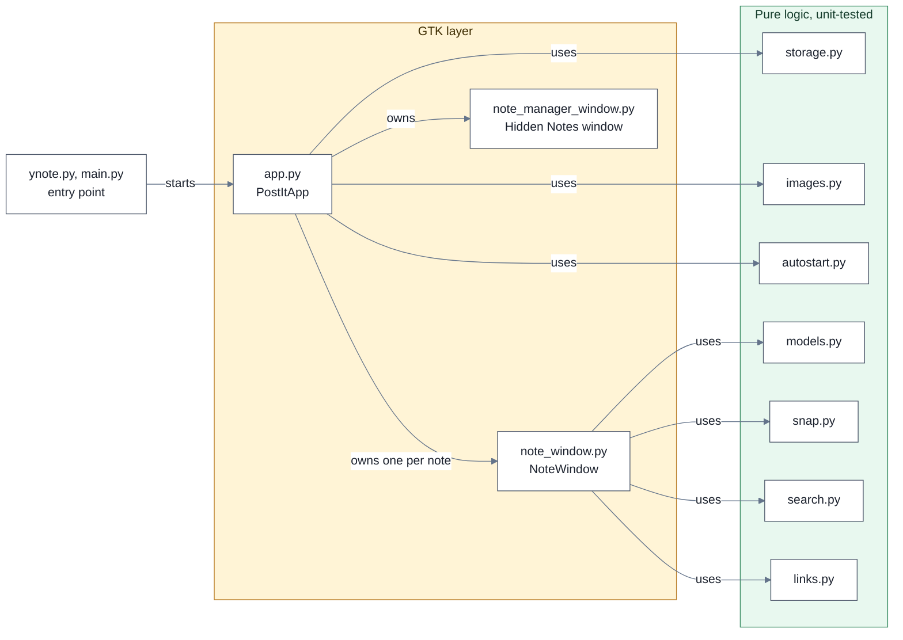
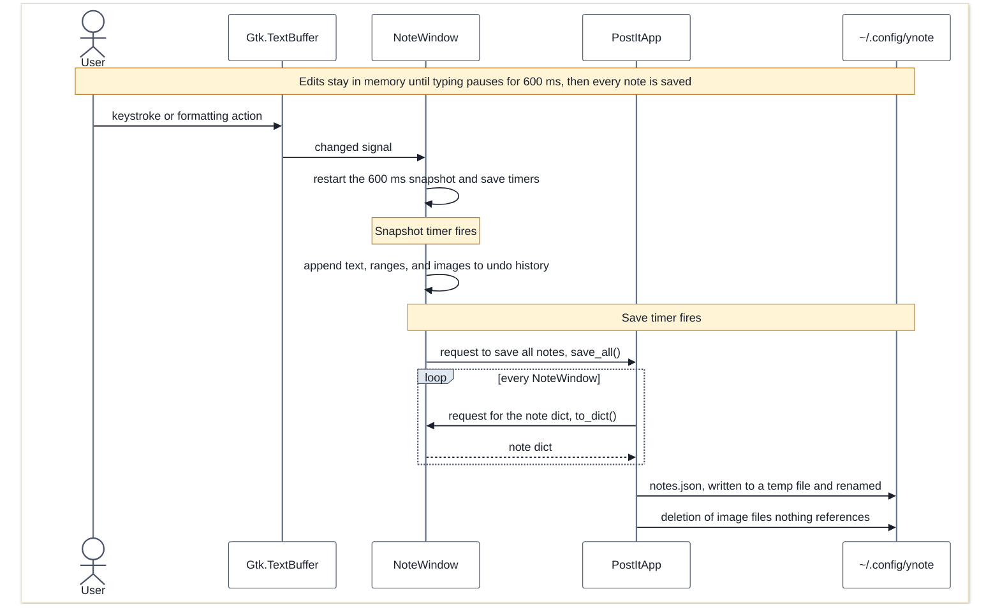

# Ynote Architecture

Ynote is a single-process GTK 3 app written in Python with PyGObject. One
`Gtk.Application` (`PostItApp`) owns every note window, and each note is a
`NoteWindow` holding a `Gtk.TextView`. Everything a user creates is saved
under `~/.config/ynote/`.

## Modules

This diagram shows which module owns or uses which. The pure modules have no
GTK dependency, so they are unit-tested without a display.



| Module | Responsibility |
| --- | --- |
| `ynote.py`, `ynote/main.py` | Entry point. Handles `--version`, selects GTK's X11 backend, then runs `PostItApp`. |
| `ynote/__init__.py` | Holds `__version__`, the only place the version is set. |
| `ynote/app.py` | Application lifecycle, tray icon, the set of notes, hidden-note order, the shared rich clipboard, and saving. |
| `ynote/note_window.py` | One note: its window, text editing and formatting, undo/redo, search, images, snapping, and the right-click popover with color, opacity, and font size. |
| `ynote/note_manager_window.py` | The Hidden Notes window: list, reorder, and restore hidden notes. |
| `ynote/models.py` | Fills defaults into saved note data, so older `notes.json` files still load. |
| `ynote/storage.py` | Reads JSON files and writes them atomically. |
| `ynote/images.py` | Image metadata, and finding and deleting image files no note uses. |
| `ynote/snap.py` | Computes a snapped note rectangle from monitor work areas. |
| `ynote/search.py` | Finds a query in every note for the search bar's All notes mode. |
| `ynote/links.py` | Finds `http` and `https` URLs in note text. |
| `ynote/autostart.py` | The per-user login autostart entry. |
| `ynote/config.py` | Paths and constants. |
| `ynote/styles.py` | The note color palette and the GTK CSS built from it. It has no GTK import, so it is unit-tested. |

## Note data model

`notes.json` is a list with one object per note. Formatting is stored as
character ranges over plain text, not as markup:

```json
{
  "id": "0b6e…", "title": "tmux", "text": "Sessions\ntmux new -s work",
  "x": 120, "y": 80, "w": 300, "h": 320,
  "on_top": false, "hidden": false, "sort_order": 0.0, "font_size": 14,
  "color": "yellow", "opacity": 1.0, "collapsed": false,
  "bold_ranges": [[0, 8]], "code_ranges": [[9, 25]], "backtick_ranges": [],
  "images": []
}
```

| Field | Meaning |
| --- | --- |
| `text` | The note text, including the special characters below. |
| `bold_ranges`, `code_ranges`, `backtick_ranges` | `[start, end)` character offsets into `text`. GTK buffer offsets count characters, so they match Python string indices. |
| `images` | `{file, original_name, offset}` per image. `offset` is where its placeholder character sits in `text`. |
| `x`, `y`, `w`, `h` | Window position and size. A maximized note saves the rectangle it had before, and a collapsed note saves its expanded height as `h`. |
| `hidden`, `sort_order` | Whether the note is hidden, and its place in the Hidden Notes list. |
| `on_top`, `font_size` | Always-on-top and the note's font size. |
| `color` | A name from the palette in `styles.py`. An unknown name loads as the default, `yellow`. |
| `opacity` | Background opacity from `0.0` to `1.0`, clamped on load. Only the note body is see-through. The title bar, bottom bar, and text stay opaque. |
| `collapsed` | Whether the note is shown as its title bar only. |

Some structure lives in the text itself:

| In `text` | Meaning |
| --- | --- |
| `U+FFFC` (`IMAGE_ANCHOR`) | Where an image is shown. |
| `U+2060` (`CODE_ANCHOR`) | An invisible character that lets an empty line carry the code tag. It is stripped when text goes to the system clipboard. |
| `• `, `☐ `, or `☑ ` at the start of a line | A bullet, an open to-do, or a done to-do. Each nesting level adds four leading spaces. |
| A line that is exactly `---` | A divider. The dashes are hidden and `_draw_dividers()` paints a line over them. |

Emoji sizing, dividers, grayed-out done to-dos, links, and search
highlights are tags derived from the text while the app runs, and are never
saved. A version without one of these features still shows the text as is.

Other files under `~/.config/ynote/`:

- `images/` holds a copy of every inserted image, named by a UUID, so a note
  keeps working after the original file moves.
- `settings.json` records app-wide state. Today that is only whether login
  autostart was already set up once.

## Editing, undo, and saving

This diagram shows what an edit causes, from the keystroke to the files on
disk.



- Moving or resizing a note also starts the save timer.
- Undo history keeps the last 100 states per note and lives only in memory.
- While the app runs, an image is kept if a note, any note's undo history, or
  the rich clipboard still refers to it. That way undo can bring back a
  deleted image. Quitting saves once more and keeps only images the saved
  notes use.

## Startup

1. `main()` sets `GDK_BACKEND=x11` before GTK loads. Otherwise GTK would pick
   any Wayland socket it finds. See [Why X11](#why-x11).
2. `PostItApp.do_startup()` creates the config directories, sets up login
   autostart on an installed app's first run, loads the CSS, and creates the
   tray icon.
3. `_load()` creates a `NoteWindow` for each saved note, or one empty note
   when there are none, then deletes image files no saved note uses.
   If `notes.json` exists but cannot be read, it is renamed to
   `notes.json.broken-<time>` instead of being overwritten, the user is
   warned, and image cleanup is skipped for that run so the kept notes'
   images survive.

## Other mechanisms

- **Rich copy and paste between notes.** Copying in a note stores the text,
  ranges, and images in `PostItApp` and puts plain text on the system
  clipboard. Pasting uses the stored state only while Ynote still owns the
  clipboard, so text copied elsewhere afterwards pastes as plain text.
- **Login autostart.** `autostart.enable_on_first_run()` writes
  `~/.config/autostart/ynote.desktop` once per user, and only when the
  `ynote` command is installed. The Start at Login menu item adds or removes
  that file.

- **Color and opacity.** Each note has one `Gtk.CssProvider` built by
  `styles.note_css()`, attached to the window and both bars. Only the note
  body gets an alpha, which needs an RGBA visual set before the window is
  realized. Below 100%, `_draw_text_backing()` paints an opaque strip behind
  each row of text so it stays readable.
- **Code blocks.** `_draw_code_blocks()` draws one box per run of code lines,
  as wide as the longest line. A multi-line selection inside a code block is
  drawn there too, because GTK would paint it across the whole note.
- **Right-click popover.** A `Gtk.Popover` is drawn inside the window it is
  attached to, so one that does not fit the note, always the case for a
  collapsed note, is attached to a transparent window of its own.
- **Collapse.** A collapsed note hides everything below the title bar and
  cannot be resized, which keeps the window manager from tiling or maximizing
  an empty note. A maximized or tiled note cannot be collapsed, because the
  window manager ignores its resizes.

## Why X11

Ynote always runs on GTK's X11 backend, through XWayland on a Wayland session.
Native Wayland does not let an app place its own windows or keep them on top,
and Ynote depends on both for saved positions, snapping, and pinning. The tray
icon (`Gtk.StatusIcon`) is an X11 mechanism too.

## Testing

The pure modules have unit tests in `tests/`. GTK code is covered by the
headless smoke test, which launches the real app. See
[CONTRIBUTING.md](CONTRIBUTING.md#test).
