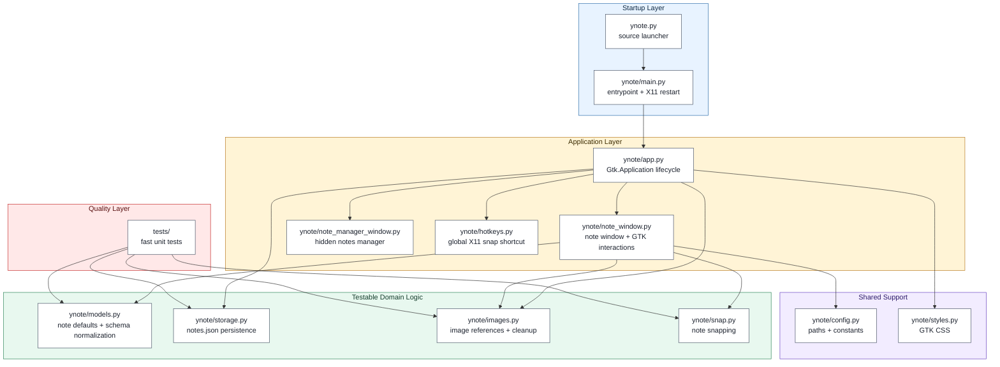

# Ynote Architecture

Ynote is organized as a small GTK desktop application with clear boundaries
between process startup, application orchestration, window/UI behavior,
persistence, and testable domain logic.

## Module structure

This diagram shows how source files are grouped by responsibility. Runtime GTK
code lives in the application layer, while persistence, image rules, and note
schema rules live in pure Python modules that can be tested without opening a
desktop window.

The design keeps desktop-specific GTK code in `note_window.py` and `app.py`,
while moving persistence, image lifecycle, note-data rules, and note snapping
into pure Python modules. Those pure modules are covered by fast unit tests, so
regressions in saved-note compatibility, image cleanup, JSON persistence, and
note snapping can be caught without requiring a graphical desktop session.

## Save and Image Cleanup Flow

This diagram shows what happens when Ynote saves notes. `PostItApp.save_all()`
collects the current state from every live `NoteWindow`, writes that state to
`notes.json`, and keeps image files that are still referenced by current notes
or runtime undo/redo history. Internally, `save_all()` calls `w.to_dict()` and
`w.history_image_files()` for each live note window.

```mermaid
flowchart LR
    subgraph Runtime["Runtime State"]
        Windows["Live note windows<br/>(NoteWindow objects)"]
    end

    subgraph SaveCoord["Save Coordination"]
        SaveAll["Save coordinator<br/>(PostItApp.save_all())"]
        Serializer["Note serializer<br/>(w.to_dict())"]
        HistoryCollector["History image collector<br/>(w.history_image_files())"]
        ReferenceSet["Image reference set<br/>(referenced_image_files())"]
    end

    subgraph Persistence["Local Persistence"]
        NotesWriter["Notes file writer<br/>(save_notes())"]
        ImageCleaner["Image cleanup worker<br/>(cleanup_orphaned_images())"]
        NotesFile[("Notes JSON file<br/>~/.config/ynote/notes.json")]
        ImagesDir[("Copied images directory<br/>~/.config/ynote/images/")]
    end

    Windows -->|"live windows"| SaveAll
    SaveAll -->|"calls"| Serializer
    SaveAll -->|"calls"| HistoryCollector
    Serializer -->|"note dict list"| NotesWriter
    NotesWriter -->|"writes notes JSON"| NotesFile
    Serializer -->|"current image refs"| ReferenceSet
    HistoryCollector -->|"history image refs"| ReferenceSet
    ReferenceSet -->|"referenced filenames"| ImageCleaner
    ImagesDir -->|"copied image files"| ImageCleaner
    ImageCleaner -->|"removes orphan files"| ImagesDir

    classDef data fill:#FFFFFF,stroke:#4A5568,stroke-width:1px,color:#1A202C

    class Windows,SaveAll,Serializer,HistoryCollector,ReferenceSet,NotesWriter,NotesFile,ImageCleaner,ImagesDir data

    style Runtime fill:#E8F3FF,stroke:#2F6FAB,stroke-width:1px,color:#102A43
    style SaveCoord fill:#E8F8EF,stroke:#2F855A,stroke-width:1px,color:#143C2B
    style Persistence fill:#FFF4D6,stroke:#B7791F,stroke-width:1px,color:#3D2C00
```

Diagram notes:

- `Note serializer` returns the current note dictionaries by using `w.to_dict()`.
- `History image collector` returns image references still reachable through undo/redo history.
- Image cleanup keeps every referenced filename and removes only orphaned copied image files.

## Module Responsibilities

| Area | Module | Responsibility |
| --- | --- | --- |
| Entrypoint | `ynote.py`, `ynote/main.py` | Preserve `python3 ynote.py` source-checkout execution and handle Wayland-to-X11 restart behavior |
| Application | `ynote/app.py` | Own the GTK application lifecycle, tray menu, note collection, hidden-note ordering, save coordination, and shutdown |
| Window/UI | `ynote/note_window.py` | Build and manage note windows, text editing, shortcuts, search, text context-menu actions, and window behavior |
| Hidden notes manager | `ynote/note_manager_window.py` | List hidden notes, restore notes, and reorder hidden notes through a dedicated GTK window |
| Data model | `ynote/models.py` | Normalize saved note data and preserve backward-compatible defaults |
| Persistence | `ynote/storage.py` | Load and save `notes.json` with atomic replacement |
| Images | `ynote/images.py` | Normalize image metadata, track references, and remove orphaned copied images |
| Styling/config | `ynote/styles.py`, `ynote/config.py` | Keep GTK CSS, paths, IDs, and shared constants out of application logic |
| Tests | `tests/` | Cover pure logic without requiring a graphical desktop session |

`ynote.py` remains as a small source launcher that imports `ynote.main`. This
keeps existing manual installs and the `python3 ynote.py` development workflow
working after the implementation moved into the `ynote/` package. The Debian
package builder installs both the launcher and the package modules.

## Why Ynote Runs on X11

Ynote runs through GTK 3's X11 backend, even when launched from a Wayland
session. Some sticky-note behaviors it relies on, such as precise window
positioning, always-on-top notes, tray/status-icon behavior, and
raising/lowering note windows, are more reliable under X11/XWayland than native
Wayland. `ynote/main.py` restarts the process with `GDK_BACKEND=x11` when it
detects a Wayland session, and the installed `ynote` launcher sets the same
variable.
