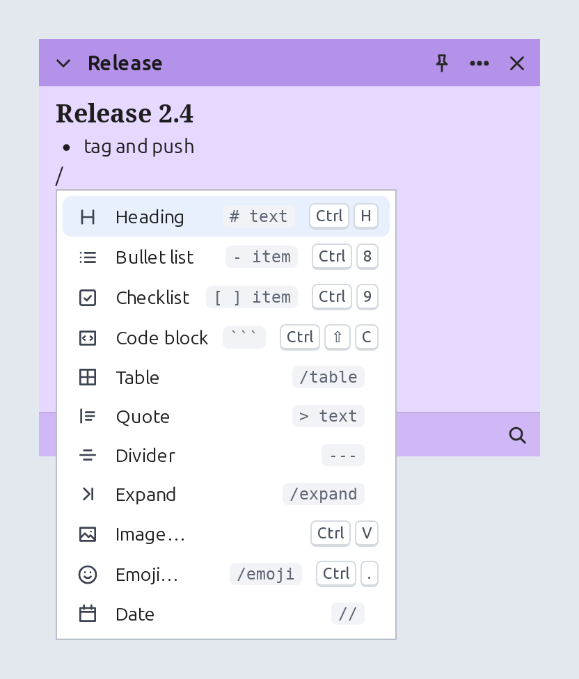
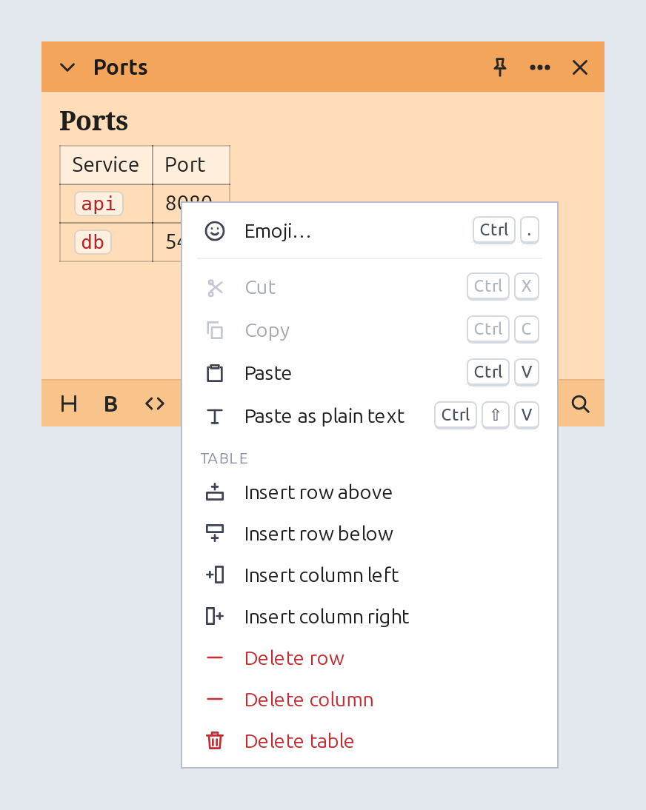
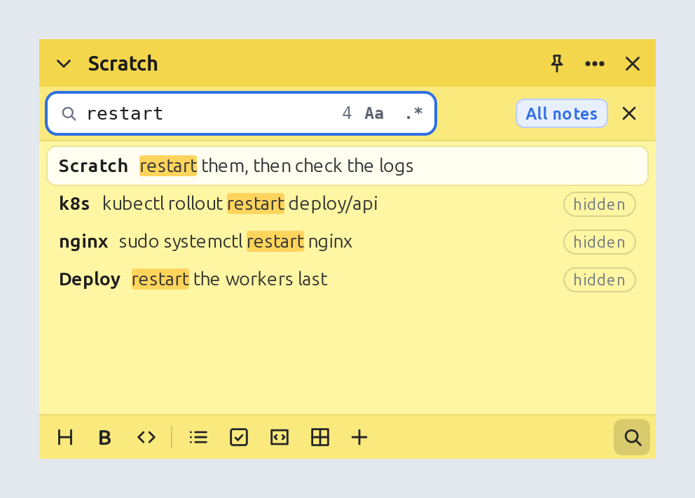
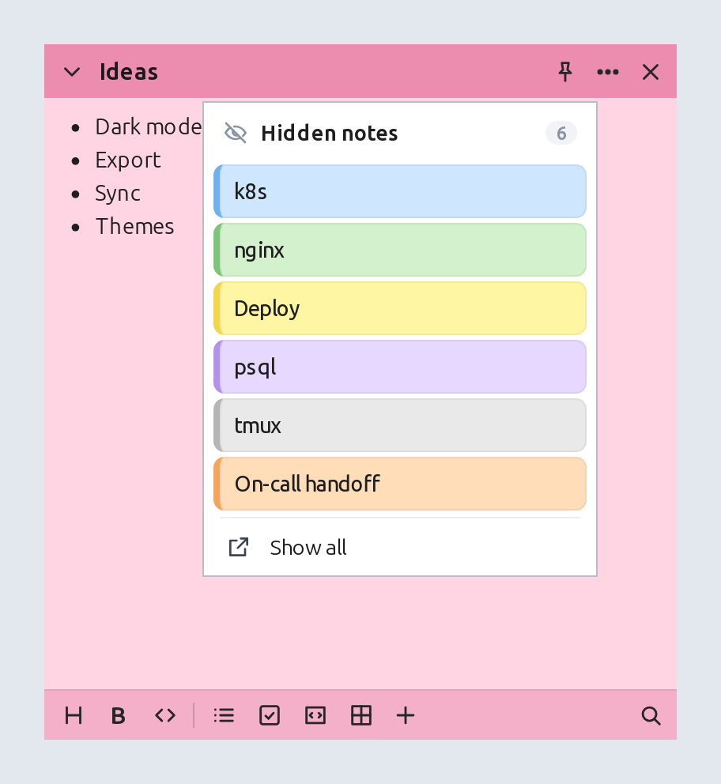
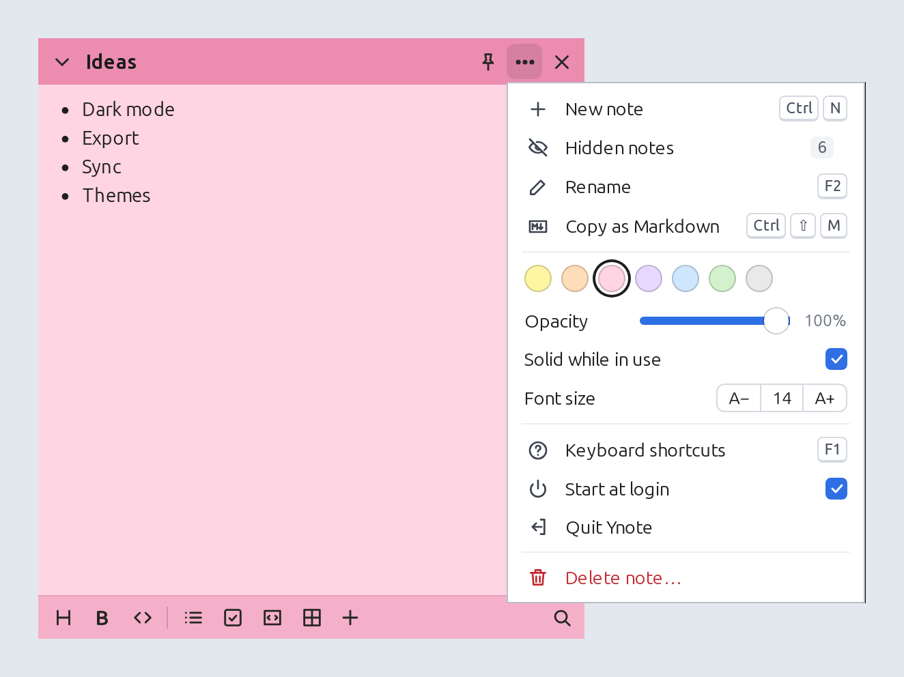
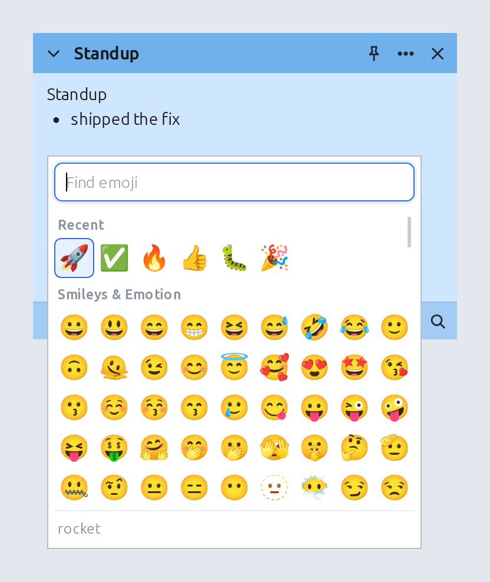
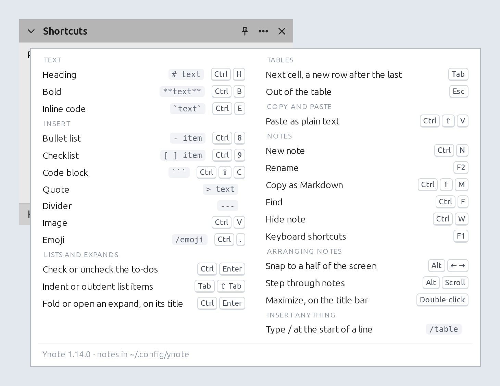

# Ynote

Engineer-friendly sticky notes for Linux desktops: commands, code, tables,
and checklists in small notes beside your editor, edited as in Confluence
and copied out as Markdown.

**[Download the .deb](https://github.com/vacu9708/ynote/releases/latest)** ·
Ubuntu 22.04 and later, and Debian-based desktops · X11 and Wayland · free
and open source (MIT)


<table>
<tr>
<td width="50%"><br><b>Type <code>/</code> to insert anything</b>, or Markdown such as <code>**bold**</code>, <code>- </code>, and <code>```</code></td>
<td width="50%"><br><b>Tables</b> whose cells hold lists, code, and formats; right-click for rows and columns</td>
</tr>
<tr>
<td><br><b>Find in every note</b>, hidden ones too, plain or as a regular expression</td>
<td><br><b>Hidden notes</b> stay out of the way until you need them</td>
</tr>
<tr>
<td><br><b>Seven colors, opacity, and font size</b>; pin a note on top or collapse it to its title bar</td>
<td><br><b>Emoji</b> found by name, the ones you use first</td>
</tr>
<tr>
<td colspan="2"><br><b>Every action has a key</b>: press <kbd>F1</kbd> in a note for the list</td>
</tr>
</table>

- **Markdown in and out:** copied text goes to other apps as Markdown, and
  code alone as it is, ready for a terminal; pasted Markdown keeps its
  formats
- **Code blocks** copy one command at a time: double-click its line, or use
  the block's Copy button
- **Arrange notes from the keyboard:** snap them into half-screen columns
  with <kbd>Alt</kbd> and the arrows, and step through them with
  <kbd>Alt</kbd> and the wheel
- **Local:** notes save as you type, in `~/.config/ynote/`, and start with
  you at login

## Install

Download `ynote_<version>.deb` from the
[latest release](https://github.com/vacu9708/ynote/releases/latest), then:

```bash
sudo apt install ./ynote_*.deb   # keep the ./
```

Run `ynote` or open it from the app grid. Notes from Ynote 1.x open as they
were, and their old file is kept as `~/.config/ynote/notes-old.json`.

## Contributing

See [CONTRIBUTING.md](CONTRIBUTING.md) and
[ARCHITECTURE.md](ARCHITECTURE.md).

## License

MIT, see [LICENSE](LICENSE). The fonts in [ynote/fonts](ynote/fonts) are
under the SIL Open Font License that comes with them.
