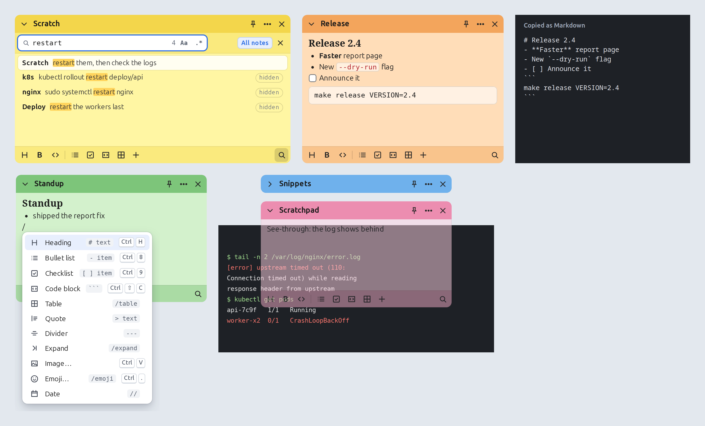

# Ynote

Engineer-friendly sticky notes for Linux desktops: commands, code, tables,
and checklists in small notes beside your editor, edited as in Confluence
and copied out as Markdown.

**[Download the .deb](https://github.com/vacu9708/ynote/releases/latest)** ·
Ubuntu 22.04 and later, and Debian-based desktops · X11 and Wayland · free
and open source (MIT)


- **Everything a note needs:** code blocks you copy one command at a time
  (double-click its line), tables whose cells hold lists and code, expands
  that fold away, checklists, headings, links, emoji, and pasted images



- **Type `/` to insert anything**, or Markdown such as `**bold**` and `- `;
  <kbd>Ctrl</kbd>+<kbd>.</kbd> finds an emoji by name
- **Find in every note**, hidden ones too, plain or as a regular expression:
  hidden notes stay out of the way and work as runbooks
- **Markdown in and out:** copy to other apps as Markdown, and code alone
  as it is, ready for a terminal; pasted Markdown keeps its formats
- **Seven colors, see-through, pinned on top, or collapsed** to the title bar
- **Arrange from the keyboard:** snap notes into half-screen columns with
  <kbd>Alt</kbd> and the arrows, and step through them with <kbd>Alt</kbd>
  and the wheel
- **Local:** notes save as you type, in `~/.config/ynote/`, and start with
  you at login

## Install

Download `ynote_<version>.deb` from the
[latest release](https://github.com/vacu9708/ynote/releases/latest), then:

```bash
sudo apt install ./ynote_*.deb   # keep the ./
```

Run `ynote` or open it from the app grid, and press <kbd>F1</kbd> in a note
for the keyboard shortcuts. Notes from Ynote 1.x open as they were, and
their old file is kept as `~/.config/ynote/notes-old.json`.

## Contributing

See [CONTRIBUTING.md](CONTRIBUTING.md) and
[ARCHITECTURE.md](ARCHITECTURE.md).

## License

MIT, see [LICENSE](LICENSE). The fonts in [ynote/fonts](ynote/fonts) are
under the SIL Open Font License that comes with them.
