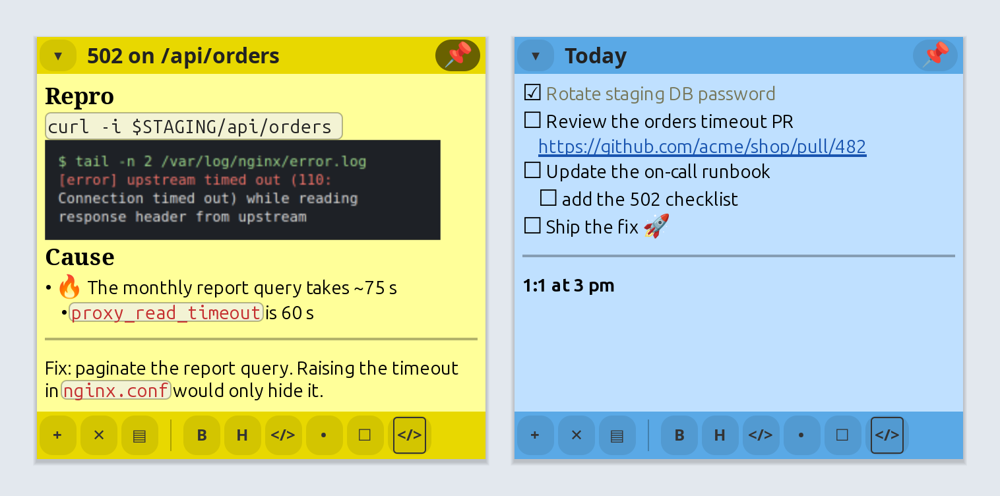
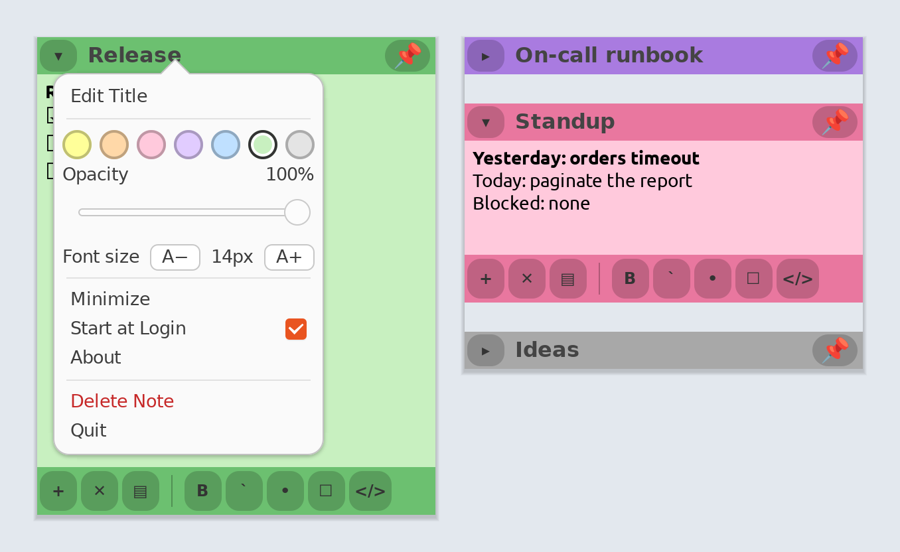

# Ynote

Engineer-friendly sticky notes for Linux desktops.



Ynote keeps the notes engineers want beside their editor (commands, code
snippets, debugging context, screenshots, and to-dos) in small floating
windows on the desktop.

Ynote runs on Debian- and Ubuntu-based Linux desktops with GTK 3 and Python
3.10 or later, including Wayland sessions. It is developed on Ubuntu 26.04.

## Features

- **Floating notes** that save automatically, with always-on-top pinning
- **Seven colors, adjustable opacity, and collapsing** a note to its title bar
- **Hidden notes** you don't need on screen, which **All notes** search still
  finds
- **Code blocks** you can copy one command at a time
- **Checklists, bullet lists, quotes, tables, expands** that fold away,
  **headings, bold text, dividers, links, inline code**, **emoji**, and
  **images**
- **Snapping** notes into half-screen columns with the keyboard




## Install

Download `ynote_<version>.deb` from the
[latest release](https://github.com/vacu9708/ynote/releases/latest), then
install it from the download folder. `apt` also installs what Ynote needs.

```bash
sudo apt install ./ynote_*.deb   # keep the ./
```

Open **Ynote** from the app grid, or run `ynote`. From then on it also starts
when you log in. To turn that off, uncheck **Start at Login** in a note's
right-click menu.

<details>
<summary>Upgrading from an <code>install.sh</code> install</summary>

Remove what `install.sh` left behind, or the old copy keeps starting instead
of the package. Then log out and back in.

```bash
sudo rm /usr/local/bin/ynote
rm ~/.local/share/applications/ynote.desktop ~/.config/autostart/ynote.desktop
```

</details>

<details>
<summary>Uninstall</summary>

```bash
sudo apt remove ynote
```

</details>

## Good to know

Buttons and menus show their shortcuts and the Markdown you can type instead.
These are the things they don't show:

- **Right-click** the title bar or bottom bar for the note's color, opacity,
  font size, rename, and delete, and **Help**, a short list of the shortcuts
  below. Double-click the title bar to maximize.
- **Format** lights up while the text at the cursor is bold, a heading, or
  inline code, and what you type next gets it. Enter turns it off.
- `Tab` and `Shift+Tab` indent list items, every selected one too, or move
  between table cells, where anything a note holds can go. Right-click a cell
  to add or delete rows and columns.
- `Ctrl+Enter` checks the to-dos on the selected lines, or folds or opens an
  expand from its title. Lines selected when you insert an expand go into it.
- Copied text goes to other apps as Markdown, and Markdown pasted in keeps its
  formats. Code alone is copied, and pasted into code, as it is. `Ctrl+V` also
  pastes an image, and `Ctrl+Shift+V` pastes text without reading Markdown.
- In a code block, double-click a line to select one command, or triple-click to
  select the whole block. `Ctrl+click` opens a link.
- `Ctrl+F` searches every note; uncheck **All notes** to search only this one.
- `Alt+` arrows snap a note into the left or right half of its monitor, move it
  up or down, or send it to a corner.
- `Alt+` scroll over a note steps through your notes from the latest used, as
  `Alt+Tab` does, so notes stacked in one place come up one after another.
- `✕` hides a note, and the eye beside it lists hidden notes. Starting Ynote
  with every note hidden opens them at the mouse pointer.
- The tray icon's menu lists your open notes, so you can jump to one that is
  buried under other windows. **Bring All to Front** in it, or a middle click on
  the icon, raises them all. If your desktop shows no tray icon, such as GNOME
  without the AppIndicator extension, Ynote works the same without it.

## Where your notes are stored

Everything is saved locally in `~/.config/ynote/`: note text in `notes.json`
and inserted images in `images/`. Each time Ynote starts, it keeps a copy of
`notes.json` as `notes.json.bak`. To back up your notes, copy that folder.
Uninstalling Ynote keeps it.

## Contributing

To run Ynote from source, run the tests, or build the package, see
[CONTRIBUTING.md](CONTRIBUTING.md). For how the code is organized, see
[ARCHITECTURE.md](ARCHITECTURE.md).

## License

Ynote is released under the MIT License. See [LICENSE](LICENSE).
